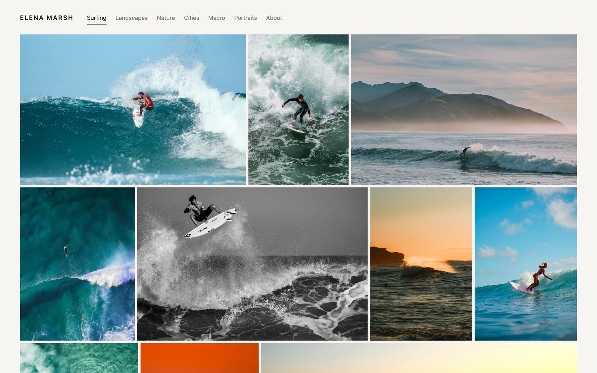
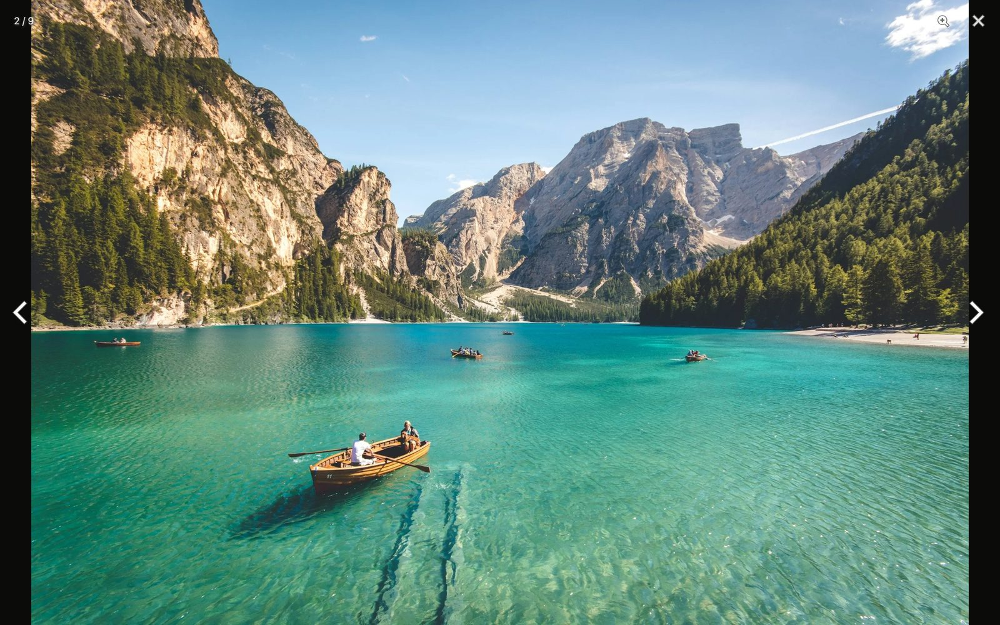
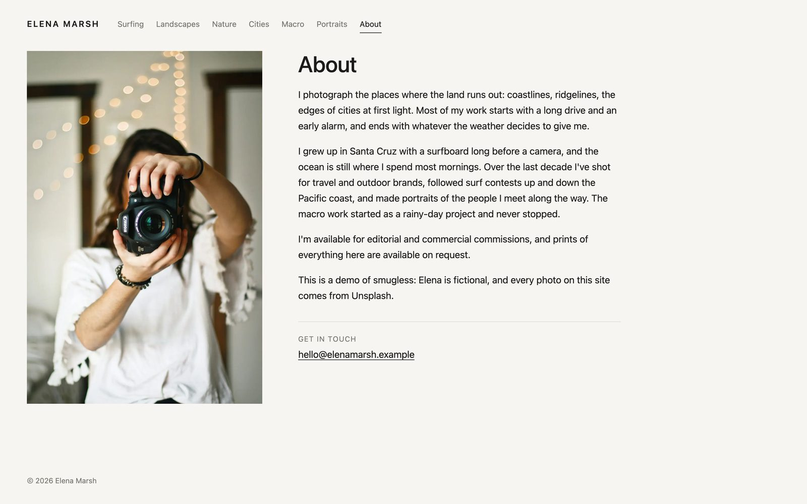
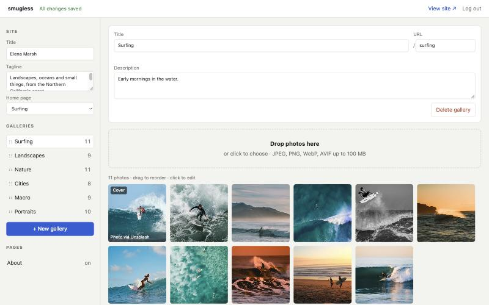

# smugless

An open-source photo portfolio website with a built-in admin for managing your galleries, built to be extremely cheap to host. Hosted portfolio services charge a monthly subscription; smugless runs on your own Cloudflare account and, for a typical portfolio, fits entirely in Cloudflare's free tiers, so you pay nothing beyond a domain name (and even that's optional).

### 👉 [Try the live demo: smugless.kuril.in](https://smugless.kuril.in)

[](https://smugless.kuril.in)

The demo is a complete portfolio for Elena Marsh, a fictional photographer, with six galleries of Unsplash photos. Things to try:

- **Click any photo** for the full-screen viewer; use the arrow keys or swipe, and pinch to zoom on a phone.
- **Browse the galleries** in the menu. The site opens straight into Surfing, but it can also open on a grid of all galleries.
- **Visit the [About page](https://smugless.kuril.in/about)**, with a portrait, bio and contact link.
- **Resize the window or open it on your phone.** Photos grow on big screens.

| [Full-screen viewer](https://smugless.kuril.in/landscapes) | [About page](https://smugless.kuril.in/about) |
|---|---|
| [](https://smugless.kuril.in/landscapes) | [](https://smugless.kuril.in/about) |

**The admin**, where you manage everything. It's password-protected on the demo, so here's what it looks like:



Under the hood it's one Worker, one private R2 bucket, and Cloudflare Images for resizing. No servers to run, no database, no build step.

## Features

**Public site**
- Galleries as justified photo grids that grow with the screen, so photos stay large on big monitors, with a full-screen lightbox (swipe, pinch-zoom, captions). Gallery pages show just the photos; titles and descriptions feed search results and link previews.
- A home page that shows either a grid of all galleries or one gallery of your choice.
- An optional About page with a portrait, a bio and a contact email.
- Responsive images in AVIF and WebP at five widths, generated on first request and cached. Resized copies carry no EXIF data, GPS included.
- Light and dark themes that follow the visitor's system setting.
- A site icon (favicon): a letter icon generated from your site title until you upload your own.

**Admin** (`/admin`, password-protected)
- Create, rename, reorder and delete galleries.
- Drag and drop photos to upload (JPEG, PNG, WebP, AVIF up to 100 MB), drag to reorder, add captions, pick a cover, move photos between galleries.
- Edit the site title, tagline, home page, site icon and About page.
- Every change saves automatically and is live immediately.

## Deploy your own

You need a Cloudflare account and Node.js.

```bash
git clone https://github.com/akurilin/smugless.git && cd smugless
npm install
npx wrangler login
npx wrangler r2 bucket create smugless-photos
npm run deploy
openssl rand -base64 18 | tr -d '\n' | tee .admin-password | npx wrangler secret put ADMIN_PASSWORD
```

Then open `https://smugless.<your-subdomain>.workers.dev/login`, sign in with the password in `.admin-password` (git-ignored), and start adding galleries.

To try it with sample content first, seed it with Unsplash photos:

```bash
SMUGLESS_URL=https://smugless.<your-subdomain>.workers.dev SMUGLESS_PASSWORD="$(cat .admin-password)" node scripts/seed.mjs
```

For a site-specific deployment, copy `wrangler.jsonc` to the ignored `wrangler.local.jsonc`. Use `env.demo` as an example and add an environment with your Worker name and R2 bucket. Run `npm run deploy -- --config wrangler.local.jsonc --env <site>`.

**Custom domain:** If the domain's DNS is on Cloudflare, add a `routes` entry with `custom_domain: true` to your Worker config. If the DNS is elsewhere, see the demo setup below.

### Google sign-in for admins

Choose `ADMIN_AUTH` per Worker. `password` is the default and uses the `ADMIN_PASSWORD` secret. `google` signs in with a Gmail or Google Workspace account that you select.

1. Create a [Web application OAuth client](https://developers.google.com/identity/openid-connect/openid-connect) in Google Cloud. Add `https://your-site.example/auth/google/callback` as an authorized redirect URI for each hostname you use. Leave authorized JavaScript origins blank.
2. Store the client secret as the `GOOGLE_CLIENT_SECRET` Worker secret. For a named local environment, run `npx wrangler secret put GOOGLE_CLIENT_SECRET --config wrangler.local.jsonc --env <site>`.
3. Add these `vars` to your site's environment in `wrangler.local.jsonc`, then deploy it.

   ```json
   "vars": {
     "ADMIN_AUTH": "google",
     "GOOGLE_CLIENT_ID": "your-client-id.apps.googleusercontent.com",
     "GOOGLE_ADMIN_EMAIL": "admin@example.com"
   }
   ```

Open `/login` to start Google sign-in. Gallery pages stay public.

## How it works

```
R2 bucket smugless-photos (private)
  manifest.json            galleries, order, titles, captions, About page: the whole site
  originals/<id>           uploaded files, never served directly
  derived/<id>/<w>.<fmt>   resized copies, made on first request
  trash/<id>               originals of deleted photos
```

- `GET /img/<id>/<width>.<avif|webp|jpg>` serves `derived/` if present; otherwise it resizes the original with the Images binding, saves it to `derived/`, and serves it. Widths are fixed at 400/800/1200/1600/2400, so each photo produces at most 15 transformations.
- Pages render on each request from `manifest.json`, so changes are live immediately.
- The admin page holds the manifest in memory and PUTs the whole thing back. The server validates it (unique, non-reserved URLs; every photo used once).
- Signing in sets a signed 30-day session cookie. In password mode, changing the password signs everyone out. Scripts in password mode can use HTTP Basic auth (any username), as `scripts/seed.mjs` does.

Code: `src/index.ts` (routes), `src/images.ts`, `src/icon.ts`, `src/manifest.ts`, `src/views.ts`, `src/auth.ts`; browser code in `public/static/`.

## Commands

```bash
npm run deploy                              # deploy
npx wrangler secret put ADMIN_PASSWORD      # change the admin password
npm run tail                                # live logs
npm run typecheck
```

## The demo

The demo is the same code deployed as a separate Worker (`smugless-demo`) with its own bucket (`smugless-demo-photos`) and password, defined as `env.demo` in `wrangler.jsonc`. `scripts/seed.mjs` fills it with six Unsplash galleries (Surfing, Landscapes, Nature, Cities, Macro, Portraits; Surfing is the home page) and an About page for Elena Marsh, a made-up photographer; the page says she's fictional. Re-running the script only adds what's missing.

```bash
npm run deploy:demo
npx wrangler secret put ADMIN_PASSWORD --env demo
npm run deploy:demo-proxy
```

`smugless.kuril.in` is served by a tiny Cloudflare Pages project, `smugless-demo-proxy` (`demo-proxy/`), whose `_worker.js` hands every request to `smugless-demo` through a service binding. kuril.in's DNS isn't on Cloudflare, and a Worker can only take a custom domain on a Cloudflare zone, but Pages accepts a subdomain by CNAME from any DNS host: kuril.in has `CNAME smugless → smugless-demo-proxy.pages.dev`. The project is classic Pages, created with `wrangler pages project create --force`; without `--force`, current wrangler turns it into a Worker, which needs a zone again.

## What it costs

smugless is designed around Cloudflare's free tiers:

| Service | Free tier | What smugless uses it for |
|---|---|---|
| Workers | 100,000 requests/day | Every page view and image request |
| R2 | 10 GB storage, no egress fees | Your originals plus their resized copies |
| Images | 5,000 unique transformations/month | Resizing each photo, once |

Why it stays inside them:
- **Each photo is resized once.** Resized copies are saved back to R2 and served from there forever after, and every photo uses at most 15 sizes (5 widths × 3 formats). 100 photos cost at most ~1,500 transformations, one time.
- **No egress fees.** R2 doesn't charge for bandwidth, so a popular gallery doesn't run up a bill.
- **No always-on server.** The Worker runs only when someone visits.

A portfolio of several hundred full-resolution photos fits comfortably in 10 GB. If you outgrow the free tiers, R2 storage is about $0.015 per GB per month and the Workers paid plan is $5/month; see Cloudflare's current [Workers](https://developers.cloudflare.com/workers/platform/pricing/), [R2](https://developers.cloudflare.com/r2/pricing/) and [Images](https://developers.cloudflare.com/images/pricing/) pricing. Uploading a very large batch in one month can pass the 5,000-transformation allowance; since resized copies are kept, that's a one-time cost.

## Limits

- Uploads go through the Worker, so 100 MB per file. Export JPEGs at full resolution; RAW/TIFF/HEIC aren't accepted.

## Not done yet

- **Backups**: R2 is the only copy of the originals. Create an R2 API token and `rclone sync` the bucket somewhere else on a schedule.
- **Redirects from an old site**: map your previous portfolio's URLs to the new galleries when migrating.

## License

MIT. Bundled libraries: [PhotoSwipe](https://photoswipe.com) and [SortableJS](https://github.com/SortableJS/Sortable), both MIT (see `public/vendor/`).
